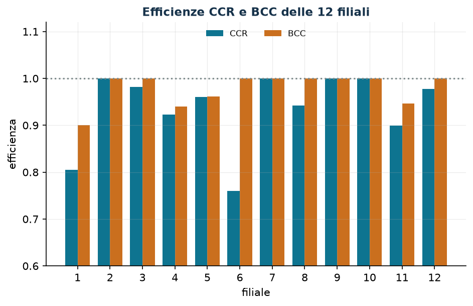
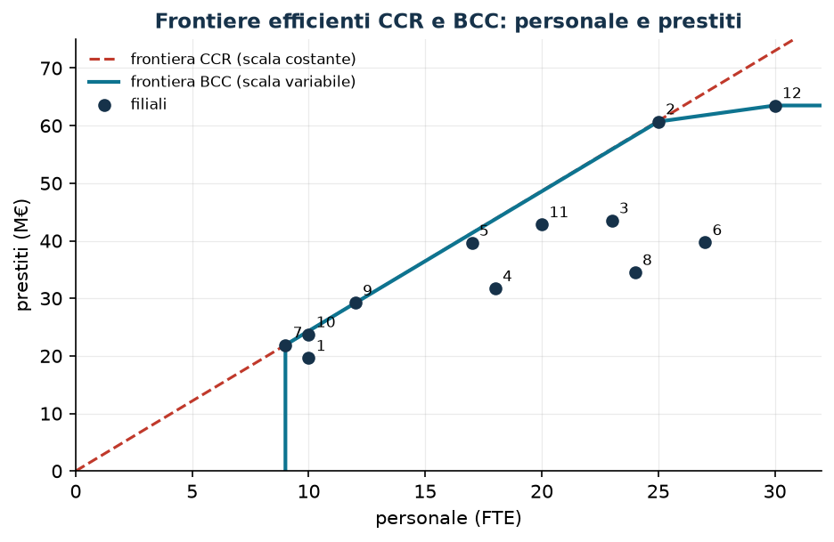

# Data Envelopment Analysis

[:material-file-pdf-box: Dispensa (PDF)](pdf/dispensa-laboratorio-ricerca-operativa.pdf) · [:material-presentation: Slide del capitolo (PDF)](pdf/slide-12-dea.pdf)

**Classe:** LP · **Script:** `python/lab12_dea.py`

[](https://colab.research.google.com/github/fabiofurini/laboratorio-ricerca-operativa/blob/main/notebooks/lab12_dea.ipynb)

Una banca ha dodici filiali: usano personale e costi operativi e producono prestiti e
depositi. Quali lavorano bene, e di quanto dovrebbero ridurre le risorse le altre? Gli
output non hanno un prezzo comune, e una filiale grande non è inefficiente solo perché
spende di più.

La **Data Envelopment Analysis** (DEA) confronta ogni filiale con le migliori pratiche
osservate risolvendo un LP per filiale, senza fissare a priori quanto vale un milione di
depositi rispetto a un milione di prestiti.

## Unità, input, output ed efficienza

Le unità confrontate si chiamano DMU (*Decision Making Unit*).

**Dati (input del modello).**

| Simbolo | Tipo | Significato |
|---|---|---|
| $n$ | $\in \mathbb{Z}_{\ge 1}$ | numero di DMU; le DMU sono indicizzate da $j \in \{1, 2, \dots, n\}$ |
| $m$ | $\in \mathbb{Z}_{\ge 1}$ | numero di input; gli input sono indicizzati da $i \in \{1, 2, \dots, m\}$ |
| $p$ | $\in \mathbb{Z}_{\ge 1}$ | numero di output; gli output sono indicizzati da $r \in \{1, 2, \dots, p\}$ |
| $x_{ij}$ | $\in \mathbb{Q}_{> 0}$ | quantità dell'input $i$ usata dalla DMU $j$ |
| $y_{rj}$ | $\in \mathbb{Q}_{> 0}$ | quantità dell'output $r$ prodotta dalla DMU $j$ |
| $o$ | $\in \{1, 2, \dots, n\}$ | la DMU che si sta valutando |

Qui $x$ e $y$ sono **dati**, non variabili: è la notazione standard della DEA.

!!! info "Definizione 12.1 — Efficienza relativa"
    Dati i pesi $u_r \ge 0$ e $v_i \ge 0$, non tutti nulli, il *rapporto di efficienza*
    della DMU $j$ è

    $$
    E_j(u, v) = \frac{\sum_{r=1}^{p} u_r\, y_{rj}}{\sum_{i=1}^{m} v_i\, x_{ij}} .
    $$

    L'*efficienza relativa* della DMU $o$ è il massimo di $E_o(u, v)$ sui pesi per cui
    nessuna DMU ha rapporto maggiore di $1$. La DMU $o$ è *efficiente* se la sua
    efficienza relativa vale $1$.

## Il modello CCR orientato all'input

Il modello di Charnes, Cooper e Rhodes (CCR) misura di quanto si possono ridurre gli
input lasciando invariati gli output.

**Il problema a parole.** *Decidiamo* i pesi degli input e degli output. *L'obiettivo* è
massimizzare il rapporto di efficienza della DMU $o$. *I vincoli* impongono che, con
quegli stessi pesi, nessuna DMU abbia rapporto maggiore di $1$.

**Variabili decisionali.** Introduciamo le seguenti $p + m$ variabili non negative:

$$
\begin{cases}
u_r = \text{peso dell'output } r, & \forall r \in \{1, 2, \dots, p\},\\[1ex]
v_i = \text{peso dell'input } i, & \forall i \in \{1, 2, \dots, m\}.
\end{cases}
$$

Usando queste variabili, il modello frazionario per la DMU $o$ è il seguente:

$$
\begin{aligned}
\max ~~ \frac{\sum_{r=1}^{p} u_r\, y_{ro}}{\sum_{i=1}^{m} v_i\, x_{io}} & & \\
\text{soggetto a} \quad \frac{\sum_{r=1}^{p} u_r\, y_{rj}}{\sum_{i=1}^{m} v_i\, x_{ij}} &\le 1, & \forall j \in \{1, 2, \dots, n\}, \\
u_r &\ge 0, & \forall r \in \{1, 2, \dots, p\}, \\
v_i &\ge 0, & \forall i \in \{1, 2, \dots, m\}.
\end{aligned}
$$

Il modello non è lineare, ma se si moltiplicano tutti i pesi per lo stesso $t > 0$
nessun rapporto cambia. Fissando $\sum_{i=1}^{m} v_i\, x_{io} = 1$ (trasformazione di
**Charnes–Cooper**) si ottiene l'LP seguente, detto *forma dei moltiplicatori*:

$$
\begin{aligned}
\max ~~ \sum_{r=1}^{p} u_r\, y_{ro} & & \\
\text{soggetto a} \quad \sum_{i=1}^{m} v_i\, x_{io} &= 1, & \\
\sum_{r=1}^{p} u_r\, y_{rj} - \sum_{i=1}^{m} v_i\, x_{ij} &\le 0, & \forall j \in \{1, 2, \dots, n\}, \\
u_r &\ge 0, & \forall r \in \{1, 2, \dots, p\}, \\
v_i &\ge 0, & \forall i \in \{1, 2, \dots, m\}.
\end{aligned}
$$

Descrizione della funzione obiettivo e dei vincoli:

- la funzione obiettivo lineare massimizza l'output pesato della DMU $o$, che è il suo
  rapporto di efficienza perché l'input pesato vale $1$;
- il vincolo lineare di **normalizzazione** fissa a $1$ l'input pesato della DMU $o$
  ($1$ vincolo lineare);
- i vincoli lineari di **rapporto** impongono che per ogni DMU l'output pesato non superi
  l'input pesato ($n$ vincoli lineari);
- i vincoli di non negatività su $u_r$ e $v_i$ definiscono le variabili del modello.

Il valore ottimo $\tilde h_o \in (0, 1]$ è l'efficienza relativa della DMU $o$; per $n$
DMU si risolvono $n$ LP.

## La forma di inviluppo: il duale

Il duale della forma dei moltiplicatori ha una variabile libera $\theta$ per il vincolo
di normalizzazione e una variabile $\lambda_j \ge 0$ per ogni vincolo di rapporto (per
aderire alla letteratura non si chiamano $\pi$). La teoria è nel capitolo
[Teoria della dualità](https://fabiofurini.github.io/programmazione-lineare/dualita/09-dualita/)
del corso di Programmazione lineare.

$$
\begin{aligned}
\min ~~ \theta & & \\
\text{soggetto a} \quad \theta\, x_{io} - \sum_{j=1}^{n} \lambda_j\, x_{ij} &\ge 0, & \forall i \in \{1, 2, \dots, m\}, \\
\sum_{j=1}^{n} \lambda_j\, y_{rj} &\ge y_{ro}, & \forall r \in \{1, 2, \dots, p\}, \\
\theta &\gtreqless 0, & \\
\lambda_j &\ge 0, & \forall j \in \{1, 2, \dots, n\}.
\end{aligned}
$$

Descrizione della funzione obiettivo e dei vincoli:

- la funzione obiettivo lineare minimizza il fattore $\theta$ con cui si contraggono
  tutti gli input della DMU $o$;
- i vincoli lineari sugli **input** impongono che la combinazione di DMU pesata con i
  $\lambda_j$ usi al più $\theta$ volte ogni input di $o$ ($m$ vincoli lineari);
- i vincoli lineari sugli **output** impongono che la stessa combinazione produca almeno
  ogni output di $o$ ($p$ vincoli lineari);
- i vincoli su $\theta$ e $\lambda_j$ definiscono le variabili del modello.

La combinazione $\sum_{j=1}^{n} \lambda_j\, (x_{\cdot j}, y_{\cdot j})$ è una DMU
**virtuale**. Con $\lambda_o = 1$ si ha $\theta = 1$, quindi $\tilde\theta \le 1$, e per
la dualità forte $\tilde\theta = \tilde h_o$. La soluzione dà:

- i **peer** di $o$: le DMU con $\tilde\lambda_j > 0$;
- i **target**: la proiezione di $o$ sulla frontiera efficiente;
- i **prezzi ombra** dei vincoli, che sono i pesi ottimi $\tilde v_i$ e $\tilde u_r$ del
  primale (uno dei vettori ottimi, se non è unico).

## Il modello BCC e l'efficienza di scala

Il CCR assume rendimenti di scala costanti. Il modello di Banker, Charnes e Cooper
(BCC) aggiunge $\sum_{j=1}^{n} \lambda_j = 1$: la DMU virtuale diventa una combinazione
**convessa**, di dimensione comparabile.

$$
\begin{aligned}
\min ~~ \theta & & \\
\text{soggetto a} \quad \theta\, x_{io} - \sum_{j=1}^{n} \lambda_j\, x_{ij} &\ge 0, & \forall i \in \{1, 2, \dots, m\}, \\
\sum_{j=1}^{n} \lambda_j\, y_{rj} &\ge y_{ro}, & \forall r \in \{1, 2, \dots, p\}, \\
\sum_{j=1}^{n} \lambda_j &= 1, & \\
\theta &\gtreqless 0, & \\
\lambda_j &\ge 0, & \forall j \in \{1, 2, \dots, n\}.
\end{aligned}
$$

Il vincolo di convessità restringe la regione, e in un problema di minimo
$\tilde\theta^{\rm BCC} \ge \tilde\theta^{\rm CCR}$.

!!! info "Definizione 12.2 — Efficienza di scala"
    $$
    \mathrm{SE}_o = \frac{\tilde\theta^{\rm CCR}_o}{\tilde\theta^{\rm BCC}_o} \in (0, 1].
    $$

    Vale $1$ alla scala più produttiva; è minore di $1$ quando una parte
    dell'inefficienza dipende solo dalla dimensione della DMU.

Nel CCR, $\sum_{j=1}^{n} \tilde\lambda_j < 1$ indica una DMU troppo piccola (rendimenti
crescenti) e $\sum_{j=1}^{n} \tilde\lambda_j > 1$ una troppo grande (rendimenti
decrescenti), quando la soluzione è unica.

## Scarti ed efficienza debole e forte

Dopo la contrazione radiale può restare un margine su un singolo input o output: gli
**scarti** $s_i^-$ e $s_r^+$. Si calcolano con una seconda fase, a $\tilde\theta$
fissato, con le variabili non negative $\lambda_j$, $s_i^-$ e $s_r^+$:

$$
\begin{aligned}
\max ~~ \sum_{i=1}^{m} s_i^- + \sum_{r=1}^{p} s_r^+ & & \\
\text{soggetto a} \quad \sum_{j=1}^{n} \lambda_j\, x_{ij} + s_i^- &= \tilde\theta\, x_{io}, & \forall i \in \{1, 2, \dots, m\}, \\
\sum_{j=1}^{n} \lambda_j\, y_{rj} - s_r^+ &= y_{ro}, & \forall r \in \{1, 2, \dots, p\}, \\
\lambda_j &\ge 0, & \forall j \in \{1, 2, \dots, n\}, \\
s_i^- &\ge 0, & \forall i \in \{1, 2, \dots, m\}, \\
s_r^+ &\ge 0, & \forall r \in \{1, 2, \dots, p\}.
\end{aligned}
$$

I target sono $\hat x_{io} = \tilde\theta\, x_{io} - \tilde s_i^-$ e
$\hat y_{ro} = y_{ro} + \tilde s_r^+$.

!!! info "Definizione 12.3 — Efficienza debole e forte"
    La DMU $o$ è *fortemente efficiente* se $\tilde\theta = 1$ e tutti gli scarti ottimi
    della seconda fase sono nulli. È *debolmente efficiente* se $\tilde\theta = 1$ ma
    almeno uno scarto è positivo.

!!! example "Esempio a mano (5 DMU, un input e un output)"
    Input $x = (2, 4, 6, 5, 2)$, output $y = (2, 6, 7, 3, 1)$. Il solver dà
    $\tilde\theta^{\rm CCR} = (0{,}6667;\ 1;\ 0{,}7778;\ 0{,}4;\ 0{,}3333)$ e
    $\tilde\theta^{\rm BCC} = (1;\ 1;\ 1;\ 0{,}5;\ 1)$.

    - **Verifica del CCR**: con un input e un output l'efficienza è $y/x$ diviso il
      migliore, $6/4 = 1{,}5$: per esempio $\tilde h_3 = (7/6)/1{,}5 = 0{,}7778$.
    - **Dualità per la DMU 1**: $\tilde u_1 = 0{,}3333$, $\tilde v_1 = 0{,}5$; il vincolo
      della DMU 2 è attivo ($6 \cdot 0{,}3333 - 4 \cdot 0{,}5 = 0$) e la DMU 2 è l'unico
      peer, con $\tilde\lambda_2 = 0{,}3333$.
    - **BCC per la DMU 4**: $\tilde\lambda_1 = 0{,}75$ e $\tilde\lambda_2 = 0{,}25$ danno
      input $2{,}5 = 0{,}5 \cdot 5$ e output $3$.
    - **Efficienza debole**: la DMU 5 ha $\tilde\theta^{\rm BCC} = 1$, ma la DMU 1 usa lo
      stesso input e produce $1$ in più: scarto $\tilde s_1^+ = 1$.

## Caso di studio

Dodici filiali, due input (personale in FTE, costi operativi in k€) e due output
(prestiti e depositi in M€). Dati sintetici realistici generati dallo script con seme
fisso, in `dati/dea_filiali.csv`.

| filiale | 1 | 2 | 3 | 4 | 5 | 6 | 7 | 8 | 9 | 10 | 11 | 12 |
|---|---|---|---|---|---|---|---|---|---|---|---|---|
| personale (FTE) | 10 | 25 | 23 | 18 | 17 | 27 | 9 | 24 | 12 | 10 | 20 | 30 |
| costi (k€) | 720 | 1420 | 1130 | 940 | 990 | 1620 | 640 | 1300 | 690 | 500 | 1020 | 1370 |
| prestiti (M€) | 19,6 | 60,7 | 43,5 | 31,7 | 39,6 | 39,7 | 21,9 | 34,5 | 29,2 | 23,7 | 42,8 | 63,5 |
| depositi (M€) | 18,5 | 58,7 | 63,0 | 50,5 | 43,2 | 73,1 | 38,0 | 72,7 | 28,7 | 26,3 | 45,7 | 62,9 |

```text
filiale    CCR     BCC   scala  somma lambda (CCR)   rendimenti
      1  0.8055  0.9000  0.8950               0.671   crescenti
      2  1.0000  1.0000  1.0000               1.000   costanti
      3  0.9815  1.0000  0.9815               1.917   decrescenti
      4  0.9233  0.9403  0.9819               1.423   decrescenti
      5  0.9604  0.9611  0.9993               1.450   decrescenti
      6  0.7600  1.0000  0.7600               1.924   decrescenti
      7  1.0000  1.0000  1.0000               1.000   costanti
      8  0.9419  1.0000  0.9419               1.913   decrescenti
      9  1.0000  1.0000  1.0000               1.000   costanti
     10  1.0000  1.0000  1.0000               1.000   costanti
     11  0.8997  0.9470  0.9501               1.641   decrescenti
     12  0.9779  1.0000  0.9779               2.679   decrescenti
Filiali CCR-efficienti: [2, 7, 9, 10]
Filiali BCC-efficienti: [2, 3, 6, 7, 8, 9, 10, 12]
```

Per tutte le filiali il valore ottimo della forma di inviluppo coincide con quello della
forma dei moltiplicatori: la dualità forte verificata numericamente.



**Peer e target degli input** (CCR, dopo la seconda fase; `dati/dea_target.csv`):

| filiale | $\tilde\theta$ | peer ($j$: $\tilde\lambda_j$) | personale | target | costi | target |
|---|---|---|---|---|---|---|
| 1 | 0,8055 | 9: 0,671 | 10 | 8,05 | 720 | 463,2 |
| 3 | 0,9815 | 7: 1,075; 10: 0,842 | 23 | 18,10 | 1130 | 1109,1 |
| 4 | 0,9233 | 7: 1,119; 10: 0,304 | 18 | 13,11 | 940 | 867,9 |
| 5 | 0,9604 | 7: 0,223; 9: 1,024; 10: 0,203 | 17 | 16,33 | 990 | 950,8 |
| 6 | 0,7600 | 7: 1,924 | 27 | 17,31 | 1620 | 1231,2 |
| 8 | 0,9419 | 7: 1,913 | 24 | 17,22 | 1300 | 1224,4 |
| 11 | 0,8997 | 2: 0,106; 10: 1,535 | 20 | 17,99 | 1020 | 917,7 |
| 12 | 0,9779 | 10: 2,679 | 30 | 26,79 | 1370 | 1339,7 |

!!! tip "Che cosa fare filiale per filiale"
    La filiale 6 è la meno efficiente ($0{,}76$) ma è efficiente nel BCC: non lavora
    male, è **troppo grande** (unico peer la filiale 7 presa $1{,}924$ volte). La
    filiale 1 è troppo piccola ($\sum \tilde\lambda_j = 0{,}671$), inefficiente anche nel
    BCC ($0{,}90$), e ha uno scarto di $116{,}8$ k€ sui costi: target $463{,}2$ k€
    contro $720$.



Nella vista a un input e un output (personale e prestiti) la frontiera CCR è la
semiretta con la pendenza migliore, $2{,}4333$ M€ per FTE della filiale 9; la frontiera
BCC passa per le filiali 7, 9, 2 e 12. Sotto la semiretta si paga inefficienza tecnica e
di scala, sotto la spezzata solo quella tecnica. In questa vista ridotta le efficienze
sono diverse da quelle del modello completo.

## Sensitività

```text
filiale 6: theta = 0.7600
  output prestiti: y = 39.7 | Pi = 0.00000 | valido per il termine noto in [-inf, 42.13]
  output depositi: y = 73.1 | Pi = 0.01040 | valido per il termine noto in [68.89, inf]
Verifica: termine noto di depositi da 73.1 a 74.1 -> theta da 0.7600 a 0.7704 (variazione +0.01040 = Pi 0.01040)
Confronto: peso u del primale = (0.00000, 0.01040)
```

Aumentare il termine noto di un vincolo $\ge$ restringe la regione, e in un problema di
minimo $\tilde\theta$ non scende: i prezzi ombra sono $\ge 0$. Il prezzo ombra dei
depositi è il peso $\tilde u_2$ del primale, e la perturbazione lo conferma. Quello dei
prestiti è nullo fino a $42{,}13$: la DMU virtuale produce già $2{,}43$ milioni di
prestiti in più (lo scarto della seconda fase).

```text
  filiale  3: CCR 0.9815 -> 1.0000  <- cambia
  filiale  4: CCR 0.9233 -> 0.9795  <- cambia
  filiale  5: CCR 0.9604 -> 0.9791  <- cambia
  filiale  6: CCR 0.7600 -> 0.9156  <- cambia
  filiale  8: CCR 0.9419 -> 1.0000  <- cambia
Senza la filiale 7: 5 filiali cambiano efficienza; nuove efficienti: [3, 8]
```

!!! warning "L'efficienza è relativa"
    Una sola DMU sulla frontiera può cambiare il giudizio su molte altre. Prima di agire
    sui target conviene controllare i dati dei peer più citati e ripetere l'analisi
    senza di essi.

## Codice

Lo script completo del capitolo — dati, modelli, dualità, sensitività e figure —
è [`python/lab12_dea.py`](https://github.com/fabiofurini/laboratorio-ricerca-operativa/blob/main/python/lab12_dea.py)
(riproducibile con `python3 python/lab12_dea.py` dalla cartella `python/`).

Lo stesso codice è disponibile come notebook — [`notebooks/lab12_dea.ipynb`](https://github.com/fabiofurini/laboratorio-ricerca-operativa/blob/main/notebooks/lab12_dea.ipynb) — che si apre in Colab dal badge in cima alla pagina e gira nel browser, senza installare niente.

??? example "Mostra lo script completo — `lab12_dea.py`"

    ```python
    """Capitolo 12 — Data Envelopment Analysis (LP).

    Caso di studio: 12 filiali di una banca (filiali 1, 2, ..., 12) confrontate su
    2 input (personale in FTE, costi operativi in migliaia di €) e 2 output
    (prestiti e depositi in milioni di €). Dati sintetici realistici generati con
    seme fisso.

    Contenuto:
      1. Dati delle filiali (generatore con seme fisso)
      2. Esempio a mano: 5 unità, un input e un output
      3. CCR orientato all'input: forma dei moltiplicatori (primale)
      4. CCR: forma di inviluppo (duale), theta = efficienza, peer e lambda
      5. BCC (rendimenti di scala variabili) ed efficienza di scala
      6. Scarti, efficienza debole e forte, target degli input
      7. Sensitività: prezzi ombra verificati per perturbazione e stabilità
      8. Figure (dati per pgfplots + anteprima matplotlib)
    """
    import gurobipy as gp
    import numpy as np
    import pandas as pd
    from gurobipy import GRB

    from stile import (ARANCIO, BLU, GRIGIO, ROSSO, TEAL, intestazione, plt, salva_dat,
                       salva_dati, salva_figura)

    TOL = 1e-6

    # ----------------------------------------------------------------------
    # 1. DATI DELLE FILIALI
    # ----------------------------------------------------------------------
    # Generatore: personale tra 8 e 30 FTE; costi proporzionali al personale con
    # una quota fissa; output da una funzione di produzione a rendimenti di scala
    # decrescenti, moltiplicata per un'inefficienza casuale exp(-|N(0, 0,25)|) e
    # ripartita fra prestiti e depositi.
    rng = np.random.default_rng(42)
    n = 12                                                    # filiali
    personale = rng.integers(8, 31, n).astype(float)          # FTE
    costi = np.round(personale * rng.uniform(38, 52, n) + rng.uniform(80, 260, n), -1)  # k€
    efficienza_vera = np.exp(-np.abs(rng.normal(0, 0.25, n)))
    volume = 9.0 * personale ** 0.55 * (costi / 100) ** 0.30 * efficienza_vera
    quota = rng.uniform(0.38, 0.62, n)
    prestiti = np.round(volume * quota, 1)                    # M€
    depositi = np.round(volume * (1 - quota) * 1.3, 1)        # M€

    filiali = list(range(1, n + 1))
    X = np.vstack([personale, costi])                         # input:  m x n
    Y = np.vstack([prestiti, depositi])                       # output: p x n
    nomi_in = ["personale", "costi"]
    nomi_out = ["prestiti", "depositi"]

    dati = pd.DataFrame({"filiale": filiali, "personale": personale.astype(int),
                         "costi_operativi": costi.astype(int),
                         "prestiti": prestiti, "depositi": depositi})
    salva_dati(dati, "dea_filiali")
    intestazione("Dati delle filiali")
    print(dati.to_string(index=False))


    def moltiplicatori(X, Y, o):
        """CCR orientato all'input, forma dei moltiplicatori (LP di Charnes-Cooper)."""
        m_, n_ = X.shape
        p_ = Y.shape[0]
        md = gp.Model("dea_moltiplicatori")
        md.Params.OutputFlag = 0
        md.Params.FeasibilityTol = 1e-9
        md.Params.OptimalityTol = 1e-9
        u = md.addVars(p_, name="u")                            # pesi degli output
        v = md.addVars(m_, name="v")                            # pesi degli input
        norm = md.addConstr(gp.quicksum(v[i] * X[i, o] for i in range(m_)) == 1,
                            name="normalizzazione")
        rapp = md.addConstrs(
            (gp.quicksum(u[r] * Y[r, j] for r in range(p_))
             - gp.quicksum(v[i] * X[i, j] for i in range(m_)) <= 0 for j in range(n_)),
            name="rapporto")
        md.setObjective(gp.quicksum(u[r] * Y[r, o] for r in range(p_)), GRB.MAXIMIZE)
        md.optimize()
        assert md.Status == GRB.OPTIMAL
        return (md.ObjVal, np.array([u[r].X for r in range(p_)]),
                np.array([v[i].X for i in range(m_)]), norm.Pi,
                np.array([rapp[j].Pi for j in range(n_)]))


    def inviluppo(X, Y, o, vrs=False, rhs_out=None):
        """Forma di inviluppo orientata all'input: CCR (vrs=False) o BCC (vrs=True).

        rhs_out sostituisce, se dato, il termine noto dei vincoli sugli output."""
        m_, n_ = X.shape
        p_ = Y.shape[0]
        md = gp.Model("dea_inviluppo")
        md.Params.OutputFlag = 0
        md.Params.FeasibilityTol = 1e-9
        md.Params.OptimalityTol = 1e-9
        theta = md.addVar(lb=-GRB.INFINITY, name="theta")
        lam = md.addVars(n_, name="lambda")
        c_in = md.addConstrs(
            (theta * X[i, o] - gp.quicksum(lam[j] * X[i, j] for j in range(n_)) >= 0
             for i in range(m_)), name="input")
        b = Y[:, o] if rhs_out is None else rhs_out
        c_out = md.addConstrs(
            (gp.quicksum(lam[j] * Y[r, j] for j in range(n_)) >= b[r] for r in range(p_)),
            name="output")
        if vrs:
            md.addConstr(lam.sum() == 1, name="convessita")
        md.setObjective(theta, GRB.MINIMIZE)
        md.optimize()
        assert md.Status == GRB.OPTIMAL
        return md, theta, lam, c_in, c_out


    def scarti(X, Y, o, theta, vrs=False):
        """Seconda fase: con theta fissato massimizza la somma degli scarti."""
        m_, n_ = X.shape
        p_ = Y.shape[0]
        md = gp.Model("dea_scarti")
        md.Params.OutputFlag = 0
        md.Params.FeasibilityTol = 1e-9
        md.Params.OptimalityTol = 1e-9
        lam = md.addVars(n_, name="lambda")
        s_in = md.addVars(m_, name="s_meno")
        s_out = md.addVars(p_, name="s_piu")
        md.addConstrs((gp.quicksum(lam[j] * X[i, j] for j in range(n_)) + s_in[i]
                       == theta * X[i, o] for i in range(m_)), name="input")
        md.addConstrs((gp.quicksum(lam[j] * Y[r, j] for j in range(n_)) - s_out[r]
                       == Y[r, o] for r in range(p_)), name="output")
        if vrs:
            md.addConstr(lam.sum() == 1, name="convessita")
        md.setObjective(s_in.sum() + s_out.sum(), GRB.MAXIMIZE)
        md.optimize()
        assert md.Status == GRB.OPTIMAL
        pulisci = lambda a: np.where(np.abs(a) < TOL, 0.0, a)
        return (pulisci(np.array([lam[j].X for j in range(n_)])),
                pulisci(np.array([s_in[i].X for i in range(m_)])),
                pulisci(np.array([s_out[r].X for r in range(p_)])))


    def testo_peer(lam):
        return " ".join(f"{j + 1}:{l:.3f}" for j, l in enumerate(lam) if l > TOL)


    # ----------------------------------------------------------------------
    # 2. ESEMPIO A MANO: 5 unità, un input e un output
    # ----------------------------------------------------------------------
    intestazione("Esempio a mano: 5 unità, un input e un output")
    Xe = np.array([[2.0, 4.0, 6.0, 5.0, 2.0]])
    Ye = np.array([[2.0, 6.0, 7.0, 3.0, 1.0]])
    for o in range(Xe.shape[1]):
        h, u, v, pi_norm, pi_rapp = moltiplicatori(Xe, Ye, o)
        md, th, lam, _, _ = inviluppo(Xe, Ye, o)
        mb, thb, _, _, _ = inviluppo(Xe, Ye, o, vrs=True)
        lam_b, sm_b, sp_b = scarti(Xe, Ye, o, thb.X, vrs=True)
        lam_c, _, _ = scarti(Xe, Ye, o, th.X)
        print(f"unità {o + 1}: x = {Xe[0, o]:.0f}, y = {Ye[0, o]:.0f}, y/x = {Ye[0, o] / Xe[0, o]:.4f} | "
              f"CCR h = {h:.4f} (u = {u[0]:.4f}, v = {v[0]:.4f}), theta = {th.X:.4f}, "
              f"lambda = {testo_peer(lam_c)} | "
              f"BCC theta = {thb.X:.4f}, lambda = {testo_peer(lam_b)}, "
              f"scarto output = {sp_b[0]:.4f}")

    # ----------------------------------------------------------------------
    # 3. CCR: FORMA DEI MOLTIPLICATORI (primale)
    # ----------------------------------------------------------------------
    intestazione("CCR orientato all'input: forma dei moltiplicatori")
    ris = {}
    for o in range(n):
        h, u, v, pi_norm, pi_rapp = moltiplicatori(X, Y, o)
        ris[o] = {"h": h, "u": u, "v": v, "pi_norm": pi_norm, "pi_rapp": pi_rapp}
        print(f"filiale {o + 1:2d}: h = {h:.4f} | u = ({u[0]:.5f}, {u[1]:.5f}) "
              f"v = ({v[0]:.5f}, {v[1]:.6f}) | Pi normalizzazione = {pi_norm:.4f}")

    # ----------------------------------------------------------------------
    # 4. CCR: FORMA DI INVILUPPO (duale), peer e lambda
    # ----------------------------------------------------------------------
    intestazione("CCR: forma di inviluppo (duale) e confronto con i moltiplicatori")
    for o in range(n):
        md, th, lam, c_in, c_out = inviluppo(X, Y, o)
        ris[o]["ccr"] = th.X
        # dualità forte: theta = h; i Pi della forma di inviluppo sono i pesi u e v
        assert abs(th.X - ris[o]["h"]) < 1e-7
        assert abs(ris[o]["pi_norm"] - th.X) < 1e-7
        pi_in = np.array([c_in[i].Pi for i in range(2)])
        pi_out = np.array([c_out[r].Pi for r in range(2)])
        print(f"filiale {o + 1:2d}: theta = {th.X:.4f} = h = {ris[o]['h']:.4f} | "
              f"Pi output = ({pi_out[0]:.5f}, {pi_out[1]:.5f}) "
              f"Pi input = ({pi_in[0]:.5f}, {pi_in[1]:.6f})")
    print("Verifica: theta (inviluppo) = h (moltiplicatori) e Pi della normalizzazione = theta "
          "per tutte le 12 filiali.")

    # ----------------------------------------------------------------------
    # 5. BCC (rendimenti di scala variabili) ed efficienza di scala
    # ----------------------------------------------------------------------
    intestazione("Efficienze CCR, BCC e di scala")
    print("filiale    CCR     BCC   scala  somma lambda (CCR)   rendimenti")
    righe_eff = []
    for o in range(n):
        mb, thb, _, _, _ = inviluppo(X, Y, o, vrs=True)
        lam, s_in, s_out = scarti(X, Y, o, ris[o]["ccr"])
        ris[o].update({"bcc": thb.X, "lam": lam, "s_in": s_in, "s_out": s_out})
        scala = ris[o]["ccr"] / thb.X
        somma = lam.sum()
        if abs(ris[o]["ccr"] - 1) < TOL:
            rts = "costanti"
        else:
            rts = "crescenti" if somma < 1 - TOL else ("decrescenti" if somma > 1 + TOL else "costanti")
        righe_eff.append((o + 1, ris[o]["ccr"], thb.X, scala, somma))
        print(f"{o + 1:7d}  {ris[o]['ccr']:.4f}  {thb.X:.4f}  {scala:.4f}  {somma:18.3f}   {rts}")
    eff = pd.DataFrame(righe_eff, columns=["filiale", "ccr", "bcc", "scala", "somma_lambda"])
    salva_dati(eff.round(6), "dea_efficienze")
    print(f"Filiali CCR-efficienti: {[o + 1 for o in range(n) if abs(ris[o]['ccr'] - 1) < TOL]}")
    print(f"Filiali BCC-efficienti: {[o + 1 for o in range(n) if abs(ris[o]['bcc'] - 1) < TOL]}")
    print(f"Efficienza CCR media: {eff['ccr'].mean():.4f}; BCC media: {eff['bcc'].mean():.4f}")

    # ----------------------------------------------------------------------
    # 6. SCARTI, EFFICIENZA DEBOLE E FORTE, TARGET
    # ----------------------------------------------------------------------
    intestazione("Scarti e target degli input (CCR, seconda fase)")
    righe_t = []
    for o in range(n):
        r = ris[o]
        deb = abs(r["ccr"] - 1) < TOL and (r["s_in"].sum() + r["s_out"].sum()) > TOL
        if deb:
            print(f"filiale {o + 1}: debolmente efficiente (theta = 1 con scarti positivi)")
        if abs(r["ccr"] - 1) < TOL:
            continue
        t_in = r["ccr"] * X[:, o] - r["s_in"]
        t_out = Y[:, o] + r["s_out"]
        righe_t.append((o + 1, r["ccr"], testo_peer(r["lam"]), *t_in, *t_out, *r["s_in"], *r["s_out"]))
        print(f"filiale {o + 1:2d}: theta = {r['ccr']:.4f} | peer {testo_peer(r['lam'])} | "
              f"scarti input ({r['s_in'][0]:.2f}, {r['s_in'][1]:.2f}) output ({r['s_out'][0]:.2f}, {r['s_out'][1]:.2f}) | "
              f"target personale {t_in[0]:.2f} (da {X[0, o]:.0f}), costi {t_in[1]:.1f} (da {X[1, o]:.0f})")
    deboli = [o + 1 for o in range(n) if abs(ris[o]["ccr"] - 1) < TOL
              and ris[o]["s_in"].sum() + ris[o]["s_out"].sum() > TOL]
    print(f"Filiali efficienti con scarti positivi (debolmente efficienti): {deboli if deboli else 'nessuna'}")
    target = pd.DataFrame(righe_t, columns=[
        "filiale", "theta", "peer", "personale_target", "costi_target", "prestiti_target",
        "depositi_target", "scarto_personale", "scarto_costi", "scarto_prestiti", "scarto_depositi"])
    salva_dati(target.round(4), "dea_target")

    efficienti = [j for j in range(n) if abs(ris[j]["ccr"] - 1) < TOL]
    conta = {j + 1: sum(1 for o in range(n) if abs(ris[o]["ccr"] - 1) > TOL and ris[o]["lam"][j] > TOL)
             for j in efficienti}
    print("Quante volte ogni filiale efficiente è peer di una inefficiente: "
          + ", ".join(f"{j}: {c}" for j, c in conta.items()))

    # ----------------------------------------------------------------------
    # 7. SENSITIVITÀ: prezzi ombra verificati per perturbazione e stabilità
    # ----------------------------------------------------------------------
    intestazione("Sensitività: prezzi ombra dei vincoli sugli output (filiale meno efficiente)")
    o_min = int(eff["ccr"].idxmin())
    md, th, lam, c_in, c_out = inviluppo(X, Y, o_min)
    print(f"filiale {o_min + 1}: theta = {th.X:.4f}")
    for r in range(2):
        c = c_out[r]
        print(f"  output {nomi_out[r]:8s}: y = {Y[r, o_min]:.1f} | Pi = {c.Pi:.5f} | "
              f"valido per il termine noto in [{c.SARHSLow:.2f}, {c.SARHSUp:.2f}]")
    r_star = int(np.argmax([c_out[r].Pi for r in range(2)]))
    nuovo = Y[:, o_min].copy()
    nuovo[r_star] += 1
    md2, th2, _, _, _ = inviluppo(X, Y, o_min, rhs_out=nuovo)
    print(f"Verifica: termine noto di {nomi_out[r_star]} da {Y[r_star, o_min]:.1f} a {nuovo[r_star]:.1f} "
          f"-> theta da {th.X:.4f} a {th2.X:.4f} (variazione {th2.X - th.X:+.5f} = Pi {c_out[r_star].Pi:.5f})")
    print(f"Confronto: peso u del primale = ({ris[o_min]['u'][0]:.5f}, {ris[o_min]['u'][1]:.5f})")

    intestazione("Stabilità: si toglie il peer più citato e si ricalcola la CCR")
    j_peer = max(conta, key=conta.get) - 1
    resto = [j for j in range(n) if j != j_peer]
    Xr, Yr = X[:, resto], Y[:, resto]
    cambi = []
    for k, o in enumerate(resto):
        md, th, _, _, _ = inviluppo(Xr, Yr, k)
        cambi.append((o + 1, ris[o]["ccr"], th.X))
        seg = "  <- cambia" if th.X - ris[o]["ccr"] > 1e-6 else ""
        print(f"  filiale {o + 1:2d}: CCR {ris[o]['ccr']:.4f} -> {th.X:.4f}{seg}")
    print(f"Senza la filiale {j_peer + 1}: {sum(1 for c in cambi if c[2] - c[1] > 1e-6)} filiali "
          f"cambiano efficienza; nuove efficienti: "
          f"{[c[0] for c in cambi if abs(c[2] - 1) < TOL and abs(c[1] - 1) > TOL]}")

    # ----------------------------------------------------------------------
    # 8. FIGURE (dati per pgfplots + anteprima matplotlib)
    # ----------------------------------------------------------------------
    salva_dat(eff[["filiale", "ccr", "bcc"]], "cap12_efficienze")

    # vista a un input e un output: personale -> prestiti
    Xp, Yp = X[[0], :], Y[[0], :]
    bcc_p = []
    for o in range(n):
        md, th, _, _, _ = inviluppo(Xp, Yp, o, vrs=True)
        _, s_in, s_out = scarti(Xp, Yp, o, th.X, vrs=True)
        bcc_p.append((th.X, s_in.sum() + s_out.sum()))
    ccr_p = []
    for o in range(n):
        md, th, _, _, _ = inviluppo(Xp, Yp, o)
        ccr_p.append(th.X)
    frontiera = sorted((Xp[0, o], Yp[0, o]) for o in range(n)
                       if abs(bcc_p[o][0] - 1) < TOL and bcc_p[o][1] < TOL)
    pend = max(Yp[0] / Xp[0])
    x_max = 32.0
    vrs = [(frontiera[0][0], 0.0)] + frontiera + [(x_max, frontiera[-1][1])]
    salva_dat(pd.DataFrame({"filiale": filiali, "personale": Xp[0], "prestiti": Yp[0],
                            "ccr": np.round(ccr_p, 6), "bcc": np.round([b[0] for b in bcc_p], 6)}),
              "cap12_frontiera_punti")
    salva_dat(pd.DataFrame(vrs, columns=["personale", "prestiti"]), "cap12_frontiera_vrs")
    salva_dat(pd.DataFrame({"personale": [0.0, x_max], "prestiti": [0.0, pend * x_max]}),
              "cap12_frontiera_crs")
    intestazione("Vista a un input e un output: personale -> prestiti")
    print(f"Pendenza della frontiera CCR (prestiti per FTE): {pend:.4f}")
    print("Efficienze nella vista (CCR/BCC): "
          + "; ".join(f"{o + 1}: {ccr_p[o]:.3f}/{bcc_p[o][0]:.3f}" for o in range(n)))
    print("Vertici della frontiera BCC: " + ", ".join(f"({a:.0f}, {b:.1f})" for a, b in frontiera))

    fig, ax = plt.subplots()
    ax.plot([0, x_max], [0, pend * x_max], "--", color=ROSSO, label="frontiera CCR (scala costante)")
    ax.plot([a for a, _ in vrs], [b for _, b in vrs], "-", color=TEAL, lw=2,
            label="frontiera BCC (scala variabile)")
    ax.scatter(Xp[0], Yp[0], color=BLU, zorder=3, label="filiali")
    for o in range(n):
        ax.annotate(str(o + 1), (Xp[0, o], Yp[0, o]), textcoords="offset points", xytext=(4, 4),
                    fontsize=8)
    ax.set_xlim(0, x_max); ax.set_ylim(0, 75)
    ax.set_xlabel("personale (FTE)"); ax.set_ylabel("prestiti (M€)")
    ax.set_title("Frontiere efficienti CCR e BCC: personale e prestiti")
    ax.legend(fontsize=8)
    salva_figura(fig, "cap12_frontiera")

    fig, ax = plt.subplots()
    larg = 0.38
    ax.bar(np.array(filiali) - larg / 2, eff["ccr"], width=larg, color=TEAL, label="CCR")
    ax.bar(np.array(filiali) + larg / 2, eff["bcc"], width=larg, color=ARANCIO, label="BCC")
    ax.axhline(1, color=GRIGIO, ls=":")
    ax.set_xticks(filiali)
    ax.set_ylim(0.6, 1.12)
    ax.set_xlabel("filiale"); ax.set_ylabel("efficienza")
    ax.set_title("Efficienze CCR e BCC delle 12 filiali")
    ax.legend(fontsize=8, loc="upper center", ncol=2)
    salva_figura(fig, "cap12_efficienze")

    print("\nFatto: capitolo 12.")
    ```

## Esercizi

1. **Verifica** — con i pesi ottimi della filiale 4 calcolare il rapporto di tutte le
   filiali: quali hanno rapporto $1$, e che relazione c'è con i peer?
2. **Orientamento all'output** — scrivere il CCR orientato all'output e verificare
   $\tilde\varphi = 1/\tilde\theta$; nel BCC la relazione in generale non vale.
3. **Una filiale debolmente efficiente** — una filiale 13 uguale alla 7 ma con costi
   $700$ k€: $\tilde\theta$ e scarti?
4. **Restrizioni sui pesi** — aggiungere $u_2 \ge u_1$: quali filiali restano efficienti?
5. **Super-efficienza** — togliere la DMU $o$ dall'insieme di riferimento per ordinare le
   filiali efficienti: quale è la più solida?
