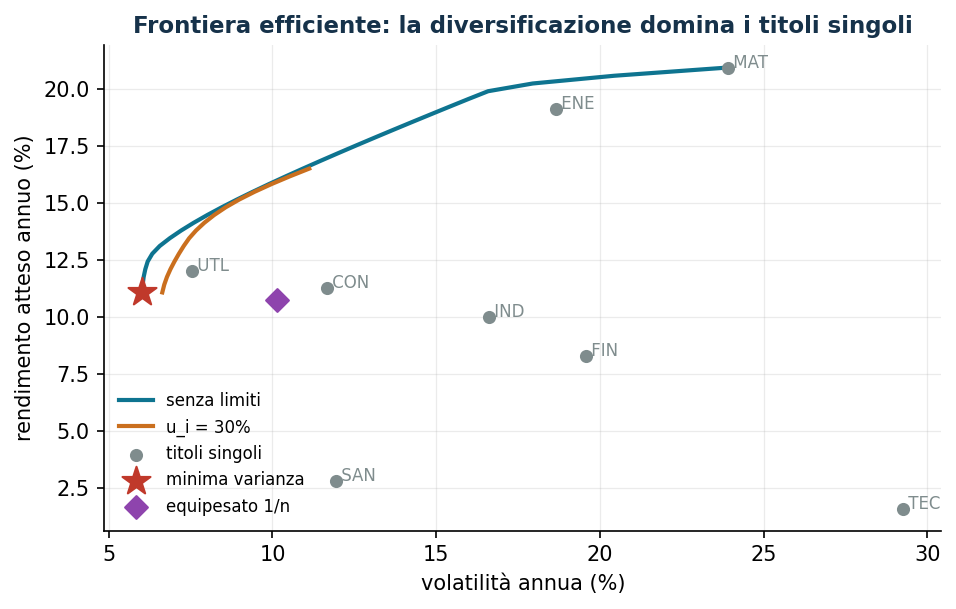

---
hide:
  - navigation
  - toc
---

# Laboratorio di Ricerca Operativa

<!-- collana-riga -->

Un corso della collana <b>Ricerca Operativa e Matematica</b> · [tutti i corsi](#la-collana)

<!-- /collana-riga -->

Materiale didattico ideato e sviluppato da **[Fabio Furini](https://fabiofurini.github.io/)**, professore
associato al [DIAG](https://www.diag.uniroma1.it/), Sapienza Università di Roma.

**Modelli continui di ottimizzazione** — la dispensa
del corso in versione online, con codice Python/Gurobi, dati e casi di studio
riproducibili.

Ogni capitolo parte da un problema gestionale concreto — quanto produrre, dove
localizzare un servizio, quale prezzo fissare, quanto rischio accettare — lo
trasforma in un modello di ottimizzazione, lo risolve con Gurobi chiamato da Python e, soprattutto, lo
*interroga*: quanto vale un'ora di capacità in più? La soluzione resiste se i dati
cambiano del 5%?

Tutti i modelli si possono eseguire **subito nel browser**: ogni capitolo ha il
suo [notebook che si apre in Colab](notebook.md), senza installare niente.

!!! tip "La domanda giusta"
    Alla fine di ogni esercitazione la domanda non è soltanto *«qual è l'ottimo?»*,
    ma *«quale decisione suggeriamo e quanto è robusta?»*. Tutte le variabili di
    decisione sono **continue**; a seconda della classe del modello la soluzione
    si legge con la dualità LP/QP, con i prezzi ombra o con le condizioni KKT.

[Comincia :material-arrow-right:](strumenti.md){ .md-button .md-button--primary }
[:material-clipboard-check-outline: Quiz](autovalutazione.md){ .md-button }
[:material-download: Materiale](materiale.md){ .md-button }

<!-- collana-app -->
## Provalo subito

La frontiera efficiente di Markowitz: ogni punto è un portafoglio ottimo per un livello di rischio. Apri il notebook in Colab, cambia i dati e rifai il calcolo con Gurobi, senza installare niente.

[:simple-googlecolab: Apri il notebook in Colab](https://colab.research.google.com/github/fabiofurini/laboratorio-ricerca-operativa/blob/main/notebooks/lab06_markowitz.ipynb){ .md-button .md-button--primary }
[:material-book-open-variant: Il capitolo](markowitz.md){ .md-button }
[:material-language-python: Tutti i notebook](notebook.md){ .md-button }
<!-- /collana-app -->

## Le parti del corso

-   :material-hammer-wrench: **Strumenti**

    ---

    Come si costruisce un modello, come si fa girare, come si leggono soluzione,
    prezzi ombra e costi ridotti: la teoria e il solver.

    [:octicons-arrow-right-24: I quattro capitoli](strumenti.md)

-   :material-factory: **Modelli deterministici**

    ---

    Produzione, supply chain, portafoglio, prezzi, budget, localizzazione,
    ricarica dei veicoli elettrici, code, efficienza delle filiali: tutti i dati
    sono noti.

    [:octicons-arrow-right-24: I nove problemi](modelli-deterministici.md)

-   :material-dice-multiple: **Decisioni sotto incertezza**

    ---

    Si decide prima di sapere: la regola del quantile, il rischio di coda e la
    dualità che dà il prezzo agli strumenti finanziari.

    [:octicons-arrow-right-24: I tre problemi](decisioni-incertezza.md)

-   :material-robot: **Ottimizzazione e machine learning**

    ---

    La SVM come QP convesso e la regressione robusta come LP: margine, duale,
    support vector e punti di appoggio — senza librerie di ML.

    [:octicons-arrow-right-24: I due problemi](ottimizzazione-ml.md)

<!-- collana-da-non-perdere -->
## Da non perdere

-   :material-clipboard-check-outline: **Quiz di autovalutazione**

    ---

    Un facsimile d'esame nuovo a ogni avvio: 13 domande, 33 punti, con la soluzione e il link alle dispense. In Materiale c'è anche la banca completa delle domande.

    [:octicons-arrow-right-24: Mettiti alla prova](autovalutazione.md)

-   :material-download: **Dispense in PDF**

    ---

    Dispense, eserciziari e slide in PDF, con la stessa numerazione del sito.

    [:octicons-arrow-right-24: Il materiale](materiale.md)

-   :material-language-python: **Notebook in Colab**

    ---

    Il codice del corso che gira nel browser, senza installare niente.

    [:octicons-arrow-right-24: I notebook](notebook.md)

<!-- /collana-da-non-perdere -->

---

<!-- collana -->
## La collana

Dieci corsi con la stessa impostazione: dispense online e in PDF, esercizi con le soluzioni, laboratorio interattivo e quiz di autovalutazione.

-   :material-function-variant: **[Analisi Matematica 1](https://fabiofurini.github.io/analisi-matematica-1/)**

    numeri reali, funzioni, limiti, derivate e serie, con i grafici interattivi

-   :material-matrix: **[Algebra lineare](https://fabiofurini.github.io/algebra-lineare/)**

    vettori, matrici, determinanti, sistemi lineari e autovalori, con il laboratorio di calcolo

-   :material-code-braces: **[Algoritmi](https://fabiofurini.github.io/algoritmi/)**

    rappresentazione dei numeri, pseudocodice, ordinamento e ricerca, analisi e algoritmi ricorsivi

-   :material-vector-triangle: **[Programmazione lineare](https://fabiofurini.github.io/programmazione-lineare/)**

    poliedri, algoritmo del simplesso, dualità e simplesso duale, con il laboratorio interattivo

-   :material-dots-grid: **[Programmazione lineare intera](https://fabiofurini.github.io/programmazione-lineare-intera/)**

    rilassamento continuo, disuguaglianze valide, piani di taglio, branch-and-bound e branch-and-cut

-   :material-vector-curve: **[Ottimizzazione convessa](https://fabiofurini.github.io/ottimizzazione-convessa/)**

    insiemi e funzioni convesse, problemi di ottimizzazione convessa, con grafici interattivi

-   :material-graph-outline: **[Ottimizzazione su reti](https://fabiofurini.github.io/ottimizzazione-su-reti/)**

    grafi, alberi ricoprenti, cammini minimi, flussi su reti, simplesso su reti e gestione dei progetti

-   :material-hexagon-multiple-outline: **[Ottimizzazione combinatoria](https://fabiofurini.github.io/ottimizzazione-combinatoria/)**

    zaino, bin packing, colorazione, TSP, scheduling e lot sizing, risolti in tutti i modi

-   :material-vector-polygon: **[Modellazione MIP](https://fabiofurini.github.io/modellazione-mip/)**

    modelli di programmazione lineare a variabili intere, dalla formulazione alla soluzione con i solver

-   :material-chart-timeline-variant: **Laboratorio di Ricerca Operativa** · *questo corso*

    modellazione e risoluzione di problemi di ottimizzazione con Python e i solver

<!-- /collana -->

---

Materiale didattico di **[Fabio Furini](https://fabiofurini.github.io/)** —
[DIAG](https://www.diag.uniroma1.it/), Sapienza Università di Roma.
